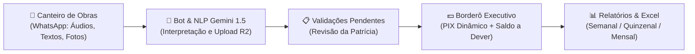

# 💼 Resumo Executivo - Ponto Patrícia (Diária.AI)
*Plataforma de Inteligência Operacional e Financeira para Canteiros de Obras & Piscinas*

---

## 1. O Problema de Negócio (A Dor do Canteiro)
Empresas de construção civil e instalação de piscinas enfrentam perdas financeiras recorrentes e atrito operacional devido a:
1. **Apontamentos Fragmentados**: Anotações informais em cadernos rasurados, mensagens dispersas no WhatsApp e esquecimento de faltas ou meio-períodos (0.5x).
2. **Descontrole de Vales e Adiantamentos**: Empréstimos ou adiantamentos solicitados na obra sem comprovante físico ou sem registro centralizado, gerando prejuízo no fechamento de sexta-feira.
3. **Litígios e Falta de Prova Pericial**: Dificuldade em comprovar para contratantes e clientes o avanço físico exato da obra, data real de concretagem/revestimento e condições climáticas do dia.
4. **Fechamento de Folha Lento e Propenso a Erros**: Horas gastas na sexta-feira somando papéis, recalculando subtotais no Excel e digitando chaves PIX uma a uma manualmente no banco.

---

## 2. A Solução: Ponto Patrícia (Diária.AI)
O **Ponto Patrícia** é um **Micro-ERP de Campo Omnichannel** potencializado por Inteligência Artificial (Google Gemini 1.5 Flash) e estruturado sob o conceito inegociável de **Human-in-the-Loop** (a máquina sugere e organiza, o ser humano decide soberanamente).

---

## 3. Pilares Estratégicos & Diferenciais Competitivos

| Pilar | Como Funciona | Impacto no Negócio |
| :--- | :--- | :--- |
| **Zero Atrito de Entrada** | Encarregados mandam áudios ou textos naturais no grupo do WhatsApp (*"Tião trabalhou dia todo, Zé meio dia"*). | Elimina a resistência da equipe de campo em usar sistemas complexos. |
| **Decisão Soberana de Vales** | Vales com fotos de recibos entram no sistema, mas **a decisão de descontar ou acumular como saldo a dever é 100% da Patrícia**. | Gestão humanizada do trabalhador sem perder o controle do saldo devedor. |
| **Date Stamp Indelével** | Fotos de obras recebem carimbo com Obra, Data/Hora de Brasília, Clima em tempo real (OpenWeather), GPS e Hash SHA-256. | Blindagem jurídica e comprovação pericial irrefutável com clientes. |
| **Sexta VIP (PIX Instantâneo)** | Geração do payload PIX Copia & Cola e QR Code dinâmico do Banco Central em 1 clique por trabalhador. | Reduz o tempo de fechamento de folha de 3 horas para menos de 10 minutos. |
| **PWA & Biometria** | Funciona em qualquer celular (iPhone ou Android) com login por Face ID ou Digital via WebAuthn. | Acesso executivo de qualquer lugar sem necessidade de lojas de apps. |

---

## 4. Arquitetura Tecnológica de Nível Enterprise
- **Frontend & Aplicação**: Next.js 14 (App Router) com TypeScript estrito, Tailwind CSS e componentes shadcn/ui.
- **Banco de Dados & RLS**: PostgreSQL gerenciado no Supabase com isolamento multi-tenant (`tenant_id`) e Row Level Security em todas as tabelas.
- **Armazenamento de Mídia**: Cloudflare R2 (S3-compatible) com bucket seguro `diaria-ai` e entrega de alta velocidade.
- **Processamento Gráfico**: Biblioteca `sharp` para composição de carimbos visuais nas fotos.
- **Relatórios**: Biblioteca `xlsx` (SheetJS) gerando planilhas executivas formatadas com 1 clique.
- **Disparo Executivo**: Integração com WhatsApp Web/API para compartilhamento instantâneo de demonstrativos.

---

## 5. Retorno sobre o Investimento (ROI)
- **Eliminação de Vales Esquecidos**: Economia estimada de 5% a 12% da folha de pagamento de canteiro.
- **Tempo Administrativo**: Economia de ~15 horas mensais dedicadas a consolidação de planilhas.
- **Transparência com a Equipe**: Envio do comprovante individual de fechamento no WhatsApp do próprio trabalhador, acabando com dúvidas e desconfianças.

