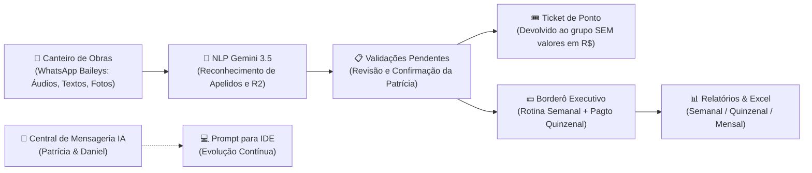

# 💼 Resumo Executivo - Ponto Patrícia (Diária.AI)
*Plataforma de Inteligência Operacional e Financeira para Canteiros de Obras & Piscinas*

---

## 1. O Problema de Negócio (A Dor do Canteiro)
Empresas de construção civil e instalação de piscinas enfrentam perdas financeiras recorrentes e atrito operacional devido a:
1. **Apontamentos Fragmentados**: Anotações informais em cadernos rasurados, mensagens dispersas no WhatsApp e esquecimento de faltas ou meio-períodos (0.5x).
2. **Descontrole de Vales e Adiantamentos**: Empréstimos ou adiantamentos solicitados na obra sem comprovante físico ou sem registro centralizado, gerando prejuízo no fechamento de sexta-feira.
3. **Litígios e Falta de Prova Pericial**: Dificuldade em comprovar para contratantes e clientes o avanço físico exato da obra, data real de concretagem/revestimento e condições climáticas do dia.
4. **Fechamento de Folha Lento e Propenso a Erros**: Horas gastas na sexta-feira somando papéis, recalculando subtotais no Excel e digitando chaves PIX uma a uma manualmente no banco.

---

## 2. A Solução: Ponto Patrícia (Diária.AI)
O **Ponto Patrícia** é um **Micro-ERP de Campo Omnichannel** potencializado por Inteligência Artificial (Google Gemini 3.5 Flash Lite), motor nativo **Baileys** (open-source) e estruturado sob o conceito inegociável de **Human-in-the-Loop** (a máquina sugere e organiza, o ser humano decide soberanamente).

---

## 3. Pilares Estratégicos & Diferenciais Competitivos

| Pilar | Como Funciona | Impacto no Negócio |
| :--- | :--- | :--- |
| **Zero Custo WhatsApp (Baileys)** | Conexão direta via QR Code sem taxas por mensagem da Meta; lê e envia para grupos fechados de canteiro (`@g.us`). | Custo operacional zero de mensageria e adoção imediata sem atrito no campo. |
| **Mapeamento de Apelidos de Campo** | A IA cruza gírias e apelidos usuais (*"Wender 22"*, *"Zé baiano"*, *"Piscina porto seguro"*) e vincula aos colaboradores e canteiros oficiais. | Zero retrabalho de digitação manual na transcrição dos pontos. |
| **Ticket Pericial sem Valores** | Ao aprovar o ponto, o sistema emite no grupo um ticket com data/hora de Brasília e hash SHA-256, **sem exibir valores em R$**. | Transparência operacional irrefutável com sigilo financeiro preservado entre os trabalhadores. |
| **Decisão Soberana de Vales** | Vales com fotos de recibos entram no sistema, mas **a decisão de descontar ou acumular como saldo a dever é 100% da Patrícia**. | Gestão humanizada do trabalhador sem perder o controle do saldo devedor. |
| **Fechamento Quinzenal com Rotina Semanal** | Consolidação e conferência toda sexta-feira no Borderô; no pagamento oficial quinzenal, a folha já está 100% conferida. | Elimina o acúmulo de 15 dias de papéis; pagamento em lote via PIX em minutos. |
| **Central de Mensageria & IA (Patrícia & Daniel)** | Chat exclusivo onde a Patrícia alinha novos relatórios com a IA, gerando prompt técnico para Daniel implementar na IDE com fechamento rastreável. | Ciclo ágil de melhoria contínua sem depender de chamados lentos ou intermediários. |
| **Date Stamp Indelével** | Fotos de obras recebem carimbo com Obra, Data/Hora de Brasília, Clima em tempo real (OpenWeather), GPS e Hash SHA-256. | Blindagem jurídica e comprovação pericial irrefutável com contratantes e clientes. |
| **PWA & Biometria** | Funciona em qualquer celular (iPhone ou Android) com login por Face ID ou Digital via WebAuthn. | Acesso executivo de qualquer lugar sem necessidade de lojas de apps. |

---

## 4. Arquitetura Tecnológica de Nível Enterprise
- **Frontend & Aplicação**: Next.js 14 (App Router) com TypeScript estrito (`strict: true`), Tailwind CSS e componentes acessíveis baseados em shadcn/ui.
- **Inteligência Artificial (NLP)**: Google Gemini API (`gemini-3.5-flash-lite`) para extração estruturada de áudios, textos e geração de prompts para a IDE.
- **Motor de Mensageria WhatsApp**: Biblioteca open-source **Baileys**, operando com sockets leves e webhooks integrados.
- **Banco de Dados & RLS**: PostgreSQL gerenciado no Supabase com isolamento multi-tenant (`tenant_id`) e Row Level Security em todas as tabelas.
- **Armazenamento de Mídia**: Cloudflare R2 (S3-compatible) com bucket seguro `diaria-ai` e entrega de alta velocidade com hash SHA-256.
- **Processamento Gráfico**: Biblioteca `sharp` para composição de carimbos visuais periciais nas fotos.
- **Relatórios**: Biblioteca `xlsx` (SheetJS) gerando planilhas executivas formatadas com 1 clique (Semanal, Quinzenal e Mensal).

---

## 5. Retorno sobre o Investimento (ROI)
- **Eliminação de Vales Esquecidos**: Economia estimada de 5% a 12% da folha de pagamento de canteiro.
- **Tempo Administrativo**: Economia de ~15 horas mensais dedicadas a consolidação de planilhas.
- **Transparência com a Equipe**: Envio do comprovante individual de fechamento no WhatsApp do próprio trabalhador e tickets oficiais no grupo, acabando com dúvidas e desconfianças.
